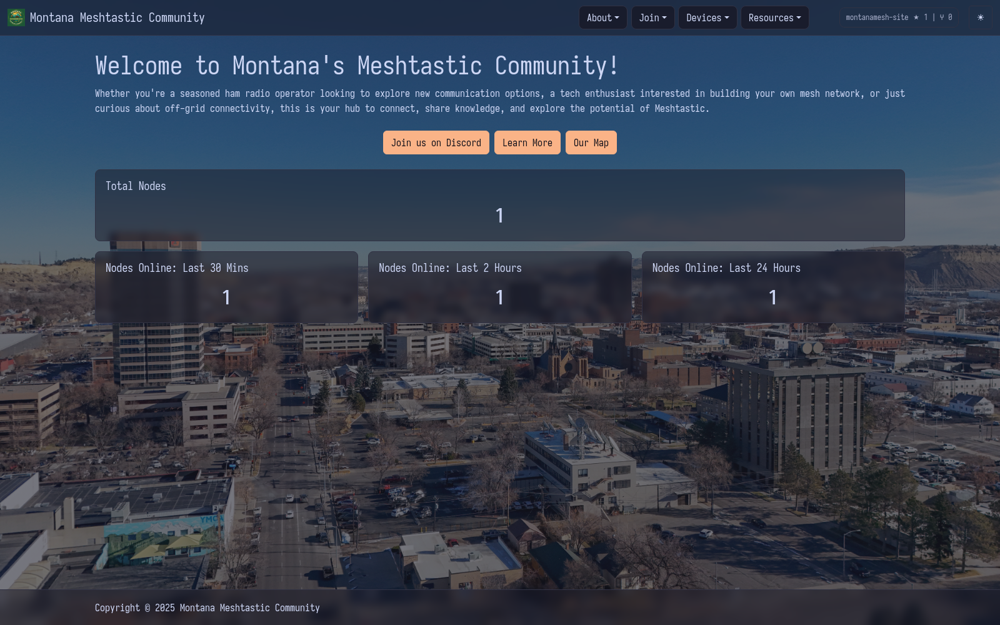

# MontanaMesh Website

The public website for the Montana Meshtastic Community. It gives new and
experienced community members one useful place to learn about the mesh, choose
hardware, configure a node, find local resources, and see a current snapshot
of network activity.

Built with ASP.NET Core MVC on .NET 8.



## What’s here

The site serves the public MontanaMesh experience, including:

- Community onboarding and connection guidance
- Device, setup, hosting, and recommended-configuration guides
- Links to the public map, dashboard, documentation, and community resources
- A privacy page, `robots.txt`, and a custom not-found page
- `GET /api/nodes/stats`, a small JSON endpoint used by the homepage telemetry

The primary public pages are available at:

`/`, `/connect`, `/devices`, `/optimal-settings`, `/host-a-node`, `/setup`,
`/recommended-configuration-settings`, `/resources`, `/contact`, and `/privacy`.

## Project layout

| Location | Purpose |
| --- | --- |
| `Controllers/` | MVC and JSON endpoint controllers |
| `Models/` | View and API response models |
| `Views/` | Razor pages and shared layout components |
| `wwwroot/` | CSS, JavaScript, images, and browser assets |
| `data/` | Node-statistics snapshots and MQTT observation state |
| `scripts/` | Maintenance helpers, including the node-stats updater |
| `docs/screenshots/` | Screenshots used in this documentation |

## Run locally

### Requirements

- .NET SDK 8.x, or a later SDK capable of building `net8.0`
- ASP.NET Core runtime 8.x

From the website directory:

```bash
dotnet run
```

The HTTP development profile listens on [http://localhost:5123](http://localhost:5123).
The HTTPS profile, when selected by your launch tooling, also uses
`https://localhost:7236`.

To confirm the project builds:

```bash
dotnet build
```

## Run in a container

This folder includes a standalone Compose definition for local container work:

```bash
podman-compose -f podman-compose.yml up -d --build
podman-compose -f podman-compose.yml ps
```

Open [http://localhost:8080](http://localhost:8080). Stop the local container
with:

```bash
podman-compose -f podman-compose.yml down
```

For the full MontanaMesh deployment, use the master-control repository’s root
Compose stack. There, the site is exposed locally on port `8082` and routed
publicly through Caddy at `montanamesh.com`.

## Live node statistics

The homepage reads its telemetry from `GET /api/nodes/stats`, backed by
`data/node-stats.json`. Refresh it manually with:

```bash
./scripts/update-node-stats.sh
```

When a readable MeshMonitor SQLite database is supplied through
`MESHMONITOR_DB_PATH`, the updater uses distinct node IDs from its `nodes`
table for the total, 30-minute, 2-hour, and 24-hour counts. It continues to
maintain `data/node-database.json` from sampled MQTT traffic, giving the site
a fallback when that database is not available.

In the production stack, `node-stats-updater` runs every five minutes. It
samples the local EMQX broker over the Compose network and mounts the
MeshMonitor data volume read-only.

### Updater configuration

The script reads the parent repository’s `.env` file when it is present. These
settings can be overridden in the environment:

| Setting | Default | Description |
| --- | --- | --- |
| `MQTT_STATS_BROKER_URL` | `mqtt://127.0.0.1:1883` | Broker used by the standalone updater. The root stack supplies `mqtt://emqx:1883`. |
| `MQTT_STATS_TOPIC` | `msh/US/#` | MQTT topic filter to sample. |
| `MQTT_STATS_TLS` | `false` | Enable TLS for the MQTT connection. |
| `MQTT_STATS_SAMPLE_SECONDS` | `60` | Length of each MQTT sampling window. |
| `MESHMONITOR_DB_PATH` | unset | Readable SQLite path used for MeshMonitor-backed counts. |
| `NODE_STATS_DATA_DIR` | `data/` | Alternate directory for generated statistics files. |

`MQTT_STATS_USERNAME` and `MQTT_STATS_PASSWORD` take precedence when set;
otherwise the updater uses `MQTT_USERNAME` and `MQTT_PASSWORD`.

## Deployment notes

This repository is a submodule of the MontanaMesh master-control workspace.
Deploy it through that workspace rather than treating this standalone Compose
file as the public production definition. The root stack provides Caddy,
Mosquitto, MeshMonitor, persistent data mounts, and the scheduled updater.

Before submitting a website change, build it locally and keep screenshots or
service documentation current whenever behavior, routes, data contracts, or
deployment assumptions change.

## Git remote

This repository uses the Montana Meshtastic Community GitHub SSH remote:

```text
git@github.com:Montana-Meshtastic-Community/montanamesh-site.git
```

## Contact form

`GET /contact` shows a name, reply email, and message form. `POST /contact`
validates the input and antiforgery token, checks a honeypot, and limits each
source IP to three attempts per ten minutes (in memory, reset on restart).
Success appears only after the SMTP server accepts the email; failed sends keep
the entered text. Messages are emailed, not written to the website data folder.
The sender stays fixed and the visitor address is set as Reply-To. Delivery uses
MailKit with explicit STARTTLS and SMTP authentication before sending. Successful
submissions log a Message-ID for provider tracing, without logging message content
or visitor addresses. SMTP acceptance does not confirm inbox delivery; check the
mailbox or provider when investigating accepted but missing messages.

Configure `Contact__SmtpHost`, `Contact__SmtpPort` (default `587`),
`Contact__EnableSsl` (default `true`, SMTP STARTTLS), `Contact__SmtpUsername`,
`Contact__SmtpPassword`, `Contact__From`, and `Contact__To` using environment
variables or local .NET user secrets. Use a verified sender address for `From`.
Implicit TLS on port 465 is not supported; use the provider’s STARTTLS endpoint.
For a local test relay only, TLS can be disabled. Without host, sender, and
recipient configuration, submission shows an unavailable message.

The master-control stack maps root `.env` settings `CONTACT_SMTP_HOST`,
`CONTACT_SMTP_PORT`, `CONTACT_ENABLE_SSL`, `CONTACT_SMTP_USERNAME`,
`CONTACT_SMTP_PASSWORD`, `CONTACT_FROM`, and `CONTACT_TO` into these options.
Keep passwords out of this public repository. Recreate the website container
when changing delivery settings. The standalone Compose file requires adding
these environment variables explicitly. Production rate limits use the source
IP supplied by the trusted reverse proxy; keep the application behind Caddy.
