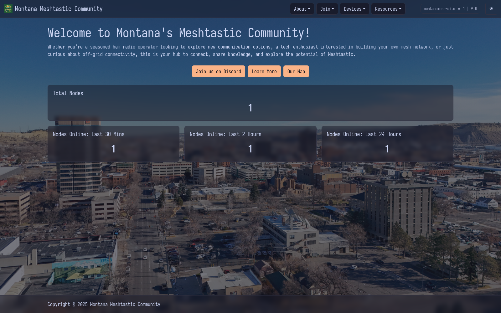

# MontanaMesh Website

The public website for the Montana Meshtastic Community. It gives new and
experienced community members one useful place to learn about the mesh, choose
hardware, configure a node, find local resources, and see a current snapshot
of network activity.

Built with ASP.NET Core MVC on .NET 8.



## What’s here

The site serves the public MontanaMesh experience, including:

- Community onboarding and connection guidance
- Device, setup, hosting, and recommended-configuration guides
- Links to the public map, dashboard, documentation, and community resources
- A privacy page, `robots.txt`, and a custom not-found page
- `GET /api/nodes/stats`, a small JSON endpoint used by the homepage telemetry

The primary public pages are available at:

`/`, `/connect`, `/devices`, `/optimal-settings`, `/host-a-node`, `/setup`,
`/recommended-configuration-settings`, `/resources`, `/contact`, and `/privacy`.

## Project layout

| Location | Purpose |
| --- | --- |
| `Controllers/` | MVC and JSON endpoint controllers |
| `Models/` | View and API response models |
| `Views/` | Razor pages and shared layout components |
| `wwwroot/` | CSS, JavaScript, images, and browser assets |
| `data/` | Node-statistics snapshots, MQTT observation state, and local-run form-protection keys |
| `scripts/` | Maintenance helpers, including the node-stats updater |
| `docs/screenshots/` | Screenshots used in this documentation |

## Run locally

### Requirements

- .NET SDK 8.x, or a later SDK capable of building `net8.0`
- ASP.NET Core runtime 8.x

From the website directory:

```bash
dotnet run
```

The HTTP development profile listens on [http://localhost:5123](http://localhost:5123).
The HTTPS profile, when selected by your launch tooling, also uses
`https://localhost:7236`.

To confirm the project builds:

```bash
dotnet build
```

## Run in a container

A standalone container serves the public pages on loopback:

```bash
podman build -t montanamesh-site .
podman run --rm -p 127.0.0.1:8080:8080 montanamesh-site
```

Open [http://localhost:8080](http://localhost:8080). Press Ctrl+C to stop the
container. For live counts, mount the directory containing the generated
`node-stats.json` at `/app/data`. The build excludes host-local data.

For the full MontanaMesh deployment, use the master-control repository’s root
Compose stack. There, the site is exposed locally on port `8082` and routed
publicly through Caddy at `montanamesh.com`.

## Live node statistics

The homepage reads its telemetry from `GET /api/nodes/stats`, backed by
`data/node-stats.json`. The API returns the count fields as strings, an
`updatedAtUtc` timestamp and, when available, `source` (`meshmonitor-db` or
`mqtt`). The homepage shows dashes when a snapshot is unavailable and labels
counts older than 15 minutes as stale. Refresh it manually with Python 3 and
`paho-mqtt` installed. Install `meshtastic` to decode protobuf payloads:

```bash
./scripts/update-node-stats.sh
```

When a readable MeshMonitor SQLite database is supplied through
`MESHMONITOR_DB_PATH`, the updater uses distinct node IDs from its `nodes`
table for the total, 30-minute, 2-hour, and 24-hour counts. It also samples MQTT
traffic and maintains `data/node-database.json` for fallback. A broker outage
still allows publication from MeshMonitor. If neither source can provide a
fresh snapshot, the updater preserves the previous counts and timestamp.

In the production stack, `node-stats-updater` runs every five minutes. It
samples the local EMQX broker over the Compose network and mounts the
MeshMonitor data volume read-only.

### Updater configuration

The script reads the parent repository’s `.env` file when it is present. These
settings can be overridden in the environment:

| Setting | Default | Description |
| --- | --- | --- |
| `MQTT_STATS_BROKER_URL` | `mqtt://127.0.0.1:1883` | Broker used by the standalone updater. The root stack supplies `mqtt://emqx:1883`. |
| `MQTT_STATS_TOPIC` | `msh/US/#` | MQTT topic filter to sample. |
| `MQTT_STATS_TLS` | infer from broker URL | Set explicitly to `true` or `false` to override the URL scheme. |
| `MQTT_STATS_SAMPLE_SECONDS` | `60` | Length of each MQTT sampling window. |
| `MESHMONITOR_DB_PATH` | unset | Readable SQLite path used for MeshMonitor-backed counts. |
| `NODE_STATS_DATA_DIR` | `data/` | Alternate directory for generated statistics files. |

`MQTT_STATS_USERNAME` and `MQTT_STATS_PASSWORD` take precedence when set;
otherwise the updater uses `MQTT_USERNAME` and `MQTT_PASSWORD`.

Run the updater regression tests from the website directory:

```bash
PYTHONPATH=scripts python3 -B -m unittest discover -s scripts/tests
```

## Deployment notes

This repository is a submodule of the MontanaMesh master-control workspace.
Deploy it through that workspace. The root stack provides Caddy, EMQX,
MeshMonitor, persistent data mounts, and the scheduled updater.

Before submitting a website change, build it locally and keep screenshots or
service documentation current whenever behavior, routes, data contracts, or
deployment assumptions change.

## Git remote

This repository uses the Montana Meshtastic Community GitHub SSH remote:

```text
git@github.com:Montana-Meshtastic-Community/montanamesh-site.git
```

## Contact form

`GET /contact` shows a name, reply email, and message form. `POST /contact`
validates the input and antiforgery token, checks a honeypot, and rejects reply
addresses MimeKit cannot parse. Only submissions that pass those checks count
toward the limit of three sends per ten minutes per source IPv4 address or
IPv6 /64 (in memory, reset on restart). A failed SMTP delivery returns its send,
and a separate cap of ten attempts per window bounds SMTP connections. Unreadable
or oversized form bodies get a plain 400 or 413. An expired form, a rejected
address, or a rate-limited send re-renders the form with the visitor's text.
Success appears only after the SMTP server accepts the email; failed sends keep
the entered text. Messages are emailed, not written to the website data folder.
The sender stays fixed and the visitor address is set as Reply-To. Delivery uses
MailKit with explicit STARTTLS and SMTP authentication before sending. Successful
submissions log a Message-ID for provider tracing, without logging message content
or visitor addresses. SMTP acceptance does not confirm inbox delivery; check the
mailbox or provider when investigating accepted but missing messages.

Configure `Contact__SmtpHost`, `Contact__SmtpPort` (default `587`),
`Contact__EnableSsl` (default `true`, SMTP STARTTLS), `Contact__SmtpUsername`,
`Contact__SmtpPassword`, `Contact__From`, and `Contact__To` using environment
variables or local .NET user secrets. Use a verified sender address for `From`.
Implicit TLS on port 465 is not supported; use the provider’s STARTTLS endpoint.
For a local test relay only, TLS can be disabled. Without host, sender, and
recipient configuration, submission shows an unavailable message.

The master-control stack maps root `.env` settings `CONTACT_SMTP_HOST`,
`CONTACT_SMTP_PORT`, `CONTACT_ENABLE_SSL`, `CONTACT_SMTP_USERNAME`,
`CONTACT_SMTP_PASSWORD`, `CONTACT_FROM`, and `CONTACT_TO` into these options.
Keep passwords out of this public repository. Recreate the website container
when changing delivery settings. For a standalone container, pass a host-local
environment file with the `Contact__*` settings using `podman run --env-file`.
Production rate limits use the source IP supplied by the trusted reverse
proxy. Keep the application behind Caddy.

Antiforgery and TempData keys persist so forms opened before a redeploy still
submit. Locally they default to the git-ignored `data/dataprotection-keys/`; the
master-control stack sets `DataProtection__KeysPath=/app/keys` on a website-only
named volume. Never commit key files.

## Security headers

Forwarded headers are applied first, so HSTS and secure cookies see Caddy's
HTTPS scheme. Every response sets a Content Security Policy (same-origin assets,
plus `https://api.github.com` for repository stats), `nosniff`, `DENY` framing,
and a strict referrer policy, and omits the `Server` header. Keep scripts and
styles in `wwwroot/`; inline `<script>` or `<style>` blocks are blocked. Page
routes accept `HEAD` as well as `GET`, and error pages render for any method.
